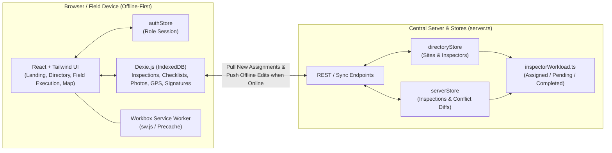

<div align="center">

# Nirikshan (निरीक्षण)

**Offline-first multi-site field inspection, workload intelligence, and conflict-free compliance platform.**

[](#offline-first--pwa-architecture)
[](#tech-stack)
[](#getting-started)
[](#tech-stack)
[](#offline-first--pwa-architecture)
[](#license)

[Features](#core-capabilities) • [Architecture](#system-architecture) • [Project Structure](#project-structure) • [Getting Started](#getting-started) • [Offline & Sync Testing](#testing-offline--conflict-sync) • [Roadmap](#roadmap)

</div>

---

## Overview

**Nirikshan** (from the Sanskrit/Hindi word for *close observation* and *inspection*) is built for industrial facilities, solar plants, farms, substations, and warehouses where cellular connectivity drops the moment an engineer steps inside.

Instead of failing when offline or overwriting concurrent edits, Nirikshan pairs a **local-first Dexie.js (IndexedDB) engine** and **Workbox service worker** with a **central directory, dynamic inspector workload tracker, and item-level conflict resolver**.

---

## Core Capabilities

| Capability | Description |
| :--- | :--- |
| **100% Offline Field Execution** | Execute checklists, record `Pass / Fail / Pending` states, attach photo evidence, tag GPS coordinates, and capture digital signatures in zero-signal environments. |
| **Item-Level Conflict Resolution** | Detects concurrent edits made by different inspectors on the same checklist item offline and surfaces side-by-side diffs without losing field data. |
| **Multi-Site & Inspector Directory** | Full CRUD management for Sites and Inspectors with archive/restore toggles and multi-field filtering (City, Country, Facility Type, Assigned Inspector). |
| **Real-Time Workload Engine** | Automatically computes each inspector's **Current Inspection Site**, **Assigned Sites**, **Pending Sites**, and **Completed Sites** across active facilities. |
| **Custom Inspection Parameters** | Create inspections with custom technical checkpoints, target thresholds, and engineering units (e.g., *Oil Temp < 75 °C*, *Valve Pressure 1.5–2.5 bar*). |
| **Role-Based Access & Showcase** | Minimal product landing showcase (`ProductLandingPage`) with role-based sign-in flows (`authStore`) for Field Inspectors and Operations Supervisors. |
| **Installable Progressive Web App** | Pre-cached application shell (`vite-plugin-pwa` + `generateSW`) with custom install prompt (`PWAInstallButton`) for mobile and tablet field devices. |

---

## System Architecture



---

## Project Structure

```text
├── public/
│   ├── icon.svg                    # Vector app icon
│   ├── apple-touch-icon.png        # iOS home screen icon
│   ├── pwa-192x192.png             # Standard PWA manifest icon
│   └── pwa-512x512.png             # High-res & maskable PWA icons
├── src/
│   ├── assets/images/              # Product showcase & field audit imagery
│   ├── components/
│   │   ├── ProductLandingPage.tsx  # Nirikshan showcase, USPs, FABs, About, Personas & Sign-In
│   │   ├── DirectoryView.tsx       # Sites & Inspectors CRUD, filters, archive/restore & workload
│   │   ├── CreateInspectionForm.tsx# Custom inspection & parameter builder
│   │   ├── FieldExecutionView.tsx  # Offline checklist execution, photo, GPS & sign-off
│   │   ├── SiteMapView.tsx         # Geospatial site overview
│   │   ├── SignaturePad.tsx        # Touch/mouse digital signature canvas
│   │   ├── ProfileView.tsx         # Inspector/Supervisor profile & session controls
│   │   └── PWAInstallButton.tsx    # Native browser PWA install trigger
│   ├── lib/
│   │   ├── db.ts                   # Dexie IndexedDB schema & pullServerInspectionsToDb()
│   │   ├── directoryStore.ts       # Site & Inspector state store
│   │   ├── serverStore.ts          # Central inspection store & item-level conflict engine
│   │   ├── inspectorWorkload.ts    # Live per-inspector site & status computation
│   │   ├── authStore.ts            # Lightweight role-based session state
│   │   ├── usePWAInstall.ts        # beforeinstallprompt hook
│   │   └── types.ts                # Shared TypeScript domain interfaces
│   ├── App.tsx                     # Root application router & layout shell
│   ├── index.css                   # Tailwind CSS v4 styles
│   └── main.tsx                    # React entry point
├── server.ts                       # Backend API & sync server
├── vite.config.ts                  # Vite + Tailwind + vite-plugin-pwa configuration
├── tsconfig.json                   # TypeScript configuration
└── package.json                    # Scripts & dependencies
```

---

## Tech Stack

- **Frontend:** React, TypeScript, Tailwind CSS v4 (`@tailwindcss/vite`)
- **Build & PWA:** Vite 8, `vite-plugin-pwa` (Workbox `generateSW`)
- **Offline Persistence:** Dexie.js (IndexedDB wrapper)
- **Server Runtime:** Node / Bun (`server.ts`)
- **Signatures & Reporting:** HTML5 Canvas Signature Pad & structured audit records

---

## Getting Started

### Prerequisites

- **Node.js** `>= 20.x` (or **Bun** `>= 1.1`)
- **npm** `>= 10.x`

### 1. Clone & Install

```bash
git clone [https://github.com/](https://github.com/)<YOUR-GITHUB-USERNAME>/<YOUR-REPO-NAME>.git
cd <YOUR-REPO-NAME>
npm install
```

### 2. Configure Environment

```bash
cp .env.example .env
```

### 3. Run in Development Mode

```bash
npm run dev
```

### 4. Production & PWA Build

```bash
./node_modules/.bin/tsc --noEmit
npm run build
```

This compiles the TypeScript bundle and generates the production service worker (`dist/sw.js` and Workbox precache manifest).

---

## Testing Offline & Conflict Sync

1. **Create a Site & Custom Inspection:**
   - Sign in as a **Supervisor / Ops Manager**, open **Directory**, add or select a site and inspector, and create an inspection with custom parameters (e.g., *Target* + *Unit*).
2. **Pull to Field Device:**
   - Switch to the assigned **Field Inspector** account—the new inspection syncs into local IndexedDB automatically.
3. **Simulate Airplane Mode:**
   - Open Chrome DevTools → **Network** → select **Offline**.
   - Complete checklist items (`Pass` / `Fail`), attach notes/photos, capture a signature, and reload the page—all data persists locally via IndexedDB and the PWA service worker.
4. **Reconnect & Resolve Conflicts:**
   - Switch DevTools back to **No throttling (Online)**. Local edits push automatically; if two inspectors modified the same checklist item offline, resolve the conflict cleanly in the supervisor view.

---

## Roadmap

- [x] Multi-site & multi-inspector directory with archive/restore & multi-field filtering
- [x] Dynamic per-inspector workload tracking (`Assigned`, `Pending`, `Completed`, `Current Site`)
- [x] Custom inspection creation with target thresholds & units
- [x] Offline-first IndexedDB storage, Workbox PWA precaching & pull-sync
- [x] Nirikshan product landing showcase & role-based sign-in portal
- [ ] PostgreSQL + Prisma ORM adapter for persistent multi-instance server storage
- [ ] Role-based JWT / OAuth authentication & automated audit PDF export

---

## License

Distributed under the **MIT License**. See `LICENSE` for more information.
